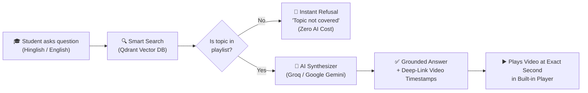
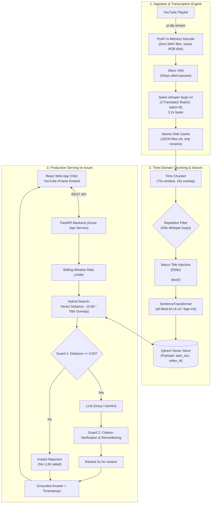
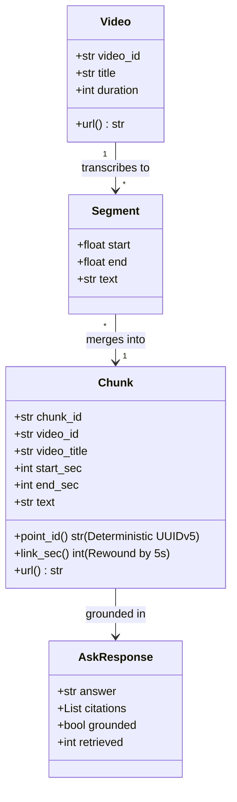
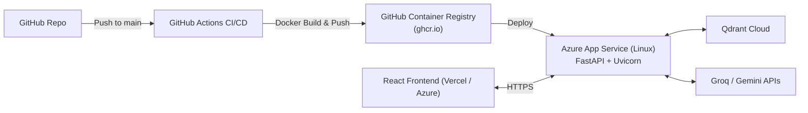

# 🎥 LectureLens — YouTube Video Q&A & Semantic Search

> **Ask questions about any video lecture in plain English or Hinglish, get an instant grounded answer, and jump to the exact second the instructor explains it.**

[](https://www.python.org/)
[](https://fastapi.tiangolo.com/)
[](https://react.dev/)
[](https://www.docker.com/)
[](https://azure.microsoft.com/)
[](https://qdrant.tech/)

---

## 💡 What Is This? (In Simple Words)

When you study from long YouTube playlists (like a 70-hour course on Data Structures & Algorithms), finding where a specific topic was explained is painful:
- You spend hours scrubbing through video timelines.
- YouTube search only looks at titles and tags, not what the teacher actually said out loud.
- Asking ChatGPT gives you a generic textbook answer, but it cannot tell you: *"Where did my teacher explain this in their course?"*

**LectureLens solves this:**
1. You ask a question in **natural Hinglish or English** (e.g. *"bhai memoization aur tabulation me kya difference hai?"*).
2. The AI searches through **68+ hours of spoken lecture audio**.
3. You get a **3-sentence direct answer** plus **interactive timestamp buttons**.
4. Clicking a timestamp opens the video and **starts playing at the exact second** the topic is discussed.

---

## 🏗️ How It Works (High-Level Flow)



---

## ⚙️ System Architecture



---

## 📊 Core Data Types (Schema)

The entire system moves data through three clean, typed models:



### Python Types Definition (`ytrag/models.py`)

- **`Video`**: Represents the YouTube lecture (`video_id`, `title`, `duration`).
- **`Segment`**: Raw speech utterance from Whisper (`start`, `end`, `text`).
- **`Chunk`**: Overlapping 75-second audio window with title injection for search indexing.
- **`AskRequest`**: User query payload (`question`, `playlist`, `top_k`, optional BYO API key).
- **`AskResponse`**: Structured answer (`answer`, `citations` with video seconds, `grounded` flag).

---

## 🚀 Key Engineering Highlights

1. **3.2x Faster Transcription:**  
   Standard Whisper takes ~27 hours for 68 hours of audio. By using `faster-whisper` (CTranslate2 `float16`) with Voice Activity Detection (VAD) and batching (`batch_size=8`), processing dropped to **~8.5 hours**.
2. **Zero Disk WAV Files:**  
   Decodes `.m4a` streams directly in memory using `PyAV`. This eliminated **8 GB+ of temporary disk writes**.
3. **95% Top-k Retrieval Accuracy (from 65%):**  
   Pure vector search often misranks speech. A **lexical title-boost reranker** (`distance - 0.08 * title_overlap`) ensures lectures explicitly titled with the topic rank first.
4. **Dual Hallucination Guard:**  
   - **Guard 1 (Pre-LLM):** If vector distance > 0.65, questions like *"How do React hooks work?"* are declined immediately without calling the LLM ($0 API cost).  
   - **Guard 2 (Post-LLM):** Citations are verified using regex and pruned. Answers without valid citations are flagged ungrounded.
5. **Rewound Deep Links:**  
   Timestamps automatically rewind by 5 seconds so the video starts just before the speaker begins the sentence, not mid-word.

---

## ☁️ Azure Cloud Deployment

The production backend runs inside a container on **Azure App Service**:



- **Containerized:** Docker multi-stage build running `python:3.11-slim` with Astral `uv`.
- **Pre-baked Vectors:** Pre-computed vectors (`vectors.npz`) load in 20 seconds at container boot.
- **Cold-Start Handling:** The React UI automatically polls Azure with up to 30 retries (90s window) and displays a clean waiting indicator if the server is waking up.

---

## 📡 API Reference

### `POST /ask`
Ask a question and receive a grounded explanation + video links.

```json
// Request
{
  "question": "memoization vs tabulation kya difference hai?",
  "playlist": "pratyush-dsa-playlist",
  "top_k": 6
}

// Response (200 OK)
{
  "answer": "Memoization top-down approach hai [1], jabki tabulation bottom-up [2].",
  "citations": [
    {
      "title": "DP Lecture 3 — Memoization Deep Dive",
      "timestamp": "12:04",
      "start_sec": 724,
      "video_id": "-AEEZEWOA-E",
      "distance": 0.38,
      "url": "https://www.youtube.com/watch?v=-AEEZEWOA-E&t=724s"
    }
  ],
  "grounded": true,
  "retrieved": 6
}
```

### `POST /search`
Instant vector search returning timestamps only (no LLM, 0s latency, free).

### `GET /health`
Returns backend status and loaded AI model information.

---

## 💻 Quickstart (Run Locally in 3 Minutes)

You don't need a GPU. 126 lecture transcripts and a prebuilt search index are included.

```bash
# 1. Clone & install
git clone <REPO_URL>
cd week3/ytscraper/backend
uv sync

# 2. Add ONE free key to .env (Groq or Google Gemini)
cp .env.example .env
# Edit .env -> GEMINI_API_KEY=... or GROQ_API_KEY=...

# 3. Load prebuilt vectors (Takes 20 seconds, CPU only)
uv run ytrag load

# 4. Start app
uv run ytrag serve
```
Open **`http://127.0.0.1:8000`** in your browser.

---

## 🛠️ CLI Commands Cheat Sheet

| Command | What It Does |
|---|---|
| `uv run ytrag load` | Loads prebuilt 126-lecture index in 20 seconds |
| `uv run ytrag search "sliding window"` | Instant terminal search (timestamps only) |
| `uv run ytrag ask "kadane intuition"` | Terminal Q&A with explanation and links |
| `uv run ytrag serve` | Starts web server & interactive video UI |
| `uv run ytrag eval` | Runs accuracy benchmark against golden test set |
| `uv run ytrag stats` | Shows indexed videos and chunk counts |
| `uv run ytrag preflight` | Diagnostic check of keys, models, and network |

---

